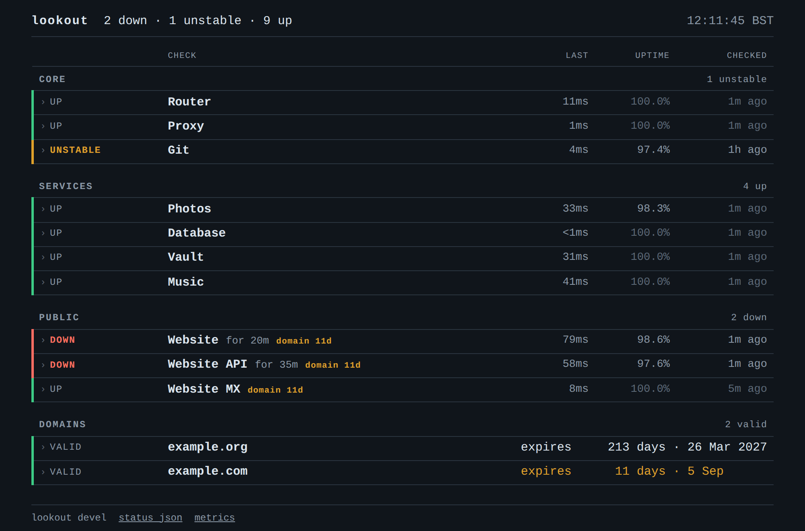

# lookout

An uptime monitor for Linux servers, with a status page and Telegram alerts.

[](https://github.com/eeegoloauq/lookout/releases/latest)
[](https://github.com/eeegoloauq/lookout/actions/workflows/ci.yml)
[](LICENSE)

<picture>
  <source media="(prefers-color-scheme: light)" srcset="docs/board-light.png">
  
</picture>

- HTTP, TCP, DNS and push checks for cron jobs
- Domain and TLS certificate expiry
- Alerts kept until Telegram confirms delivery
- JSON API and Prometheus metrics
- One binary and one YAML file

## Download

Get the [latest release](https://github.com/eeegoloauq/lookout/releases/latest) or the
`ghcr.io/eeegoloauq/lookout` container image.

## Usage

```sh
lookout demo                    # the status page with made-up data
lookout validate config.yaml
lookout run config.yaml
```

[`config.example.yaml`](config.example.yaml) documents every option.

[Setup, Docker and systemd](docs/setup.md) · [Checks and alerts](docs/usage.md)

## Development

[Build and test](docs/development.md) · [Design](docs/design.md) · [Roadmap](ROADMAP.md)

## License

[MIT](LICENSE)
